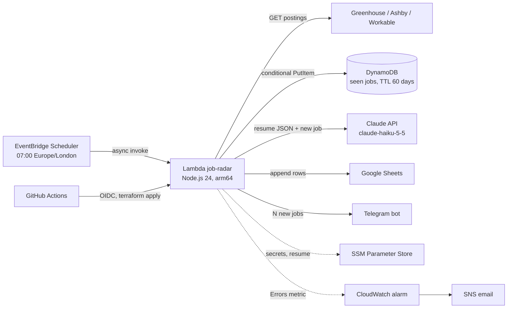

job-radar

A daily serverless job radar: pulls postings from the public Greenhouse, Ashby and Workable APIs,
filters them against my profile, asks Claude whether each new one fits my resume and whether the
resume needs tailoring for it, writes everything to Google Sheets and sends a one-line summary to
Telegram. Runs once a day on AWS Lambda for about $0.x a month.

How it works



Crawl every configured company, keep jobs that match title, location and skills.
Claim new ones in DynamoDB with a conditional write: a job is processed once, even on retries.
Send each new job (max 50 per run) with the resume as JSON to Claude. Structured output:
score 0-100, apply_as_is / tailor_resume / skip, one or two sentences of advice, gaps.

Append to the sheet. If this fails, the claim is released and the run fails (alarm).
Send "N new jobs" with the split by recommendation to Telegram. A Telegram failure is only a warning.
Decisions
Decision Why
Lambda + EventBridge Scheduler, not a server One run a day: pay for ~1 minute, not 24 hours
DynamoDB provisioned 1 RCU / 5 WCU Inside the always-free tier; on-demand is not free
SSM Parameter Store, not Secrets Manager Standard parameters are free; secrets never enter Terraform state
GitHub OIDC, no AWS keys in GitHub Short-lived credentials, plan role is read-only, apply role works only from main
Resume as validated JSON, no contact details Explicit fields for the model, a typo fails the cold start, no PII sent to the API
LLM after the dedupe, with a per-run cap Cost scales with new jobs (a few a day), not with the crawl (hundreds)
Advice, not rewritten resumes The model says what to tailor; it never writes experience I do not have
Structured outputs + zod Valid JSON by construction; ranges the schema cannot express are clamped in code
Plain fetch, no SDKs for Claude, Sheets, Telegram Bundle stays under 1 MB, cold start stays short

Run locally

```bash
npm ci
cp .env.example .env # fill in; RESUME_FILE points to a resume.json outside the repo
npm run dev -- --dry-run
npm run try:llm # prompt playground, writes nothing
npm test
```

Deploy
Infrastructure is Terraform in infra/ (state in S3 with native locking). Pull requests get a
plan comment; merges to main apply and run a dry-run smoke test. One-time setup lives in
infra/bootstrap/ (state bucket, OIDC provider, CI roles).
